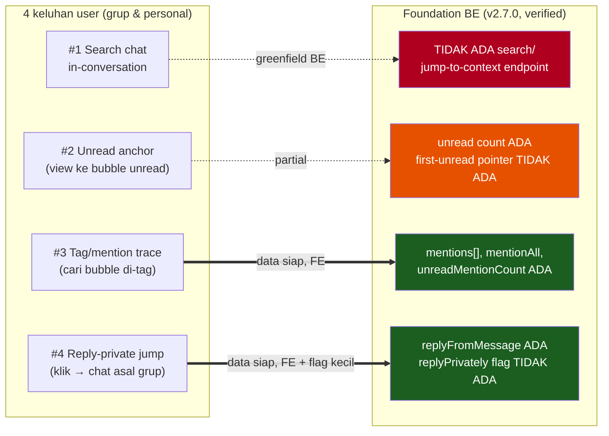
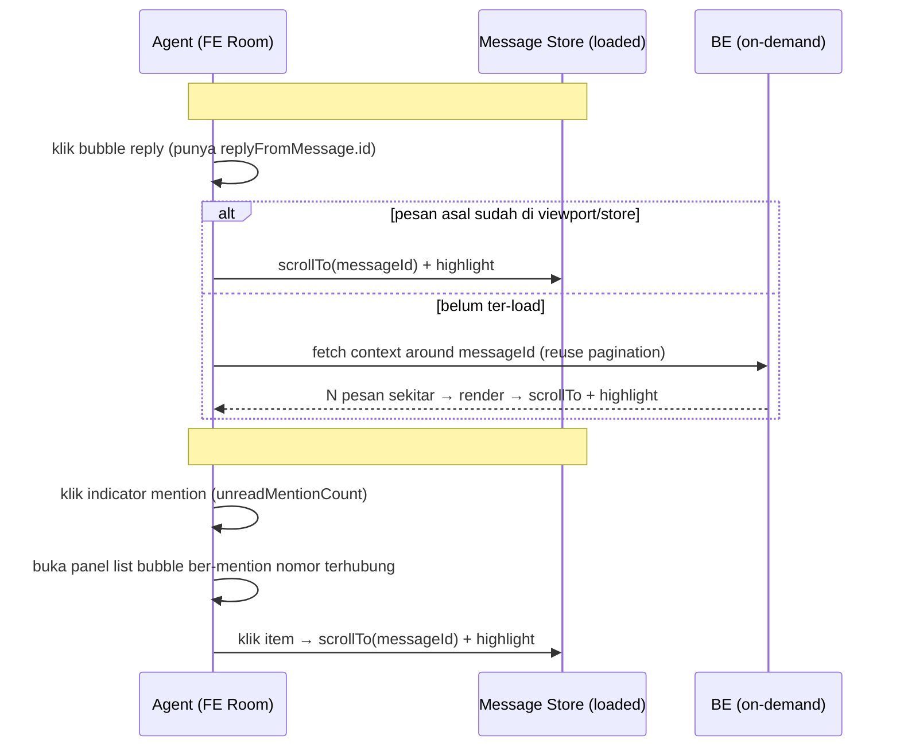
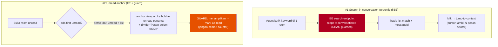

# Assessment Report: In-Chat Navigation — Sprint Readiness

> **Artifact Type:** Assessment Report (decision-bearing)
> **Artifact Path:** `Assessments/conversation/in-chat-navigation/in-chat-navigation-assessment.md`
> **Version:** `v1.1`
> **Previous Version:** `v1.0` (2026-10-14, same day)
> **Owner:** Analyst / PM — Dany Christian
> **Engineering Lead:** Naftal Yunior
> **Source Brief:** `Assessments/conversation/in-chat-navigation/in-chat-navigation-change-intake-brief.md`
> **Rules Applied:** `Rules/core/analysis-and-risk.md`, `Rules/core/change-management.md`
> **Supporting Evidence:** BE repo `omnichannel-satuinbox-be` branch `master` + FE repo `omnichannel-satuinbox-fe` branch `data-cy` (code-verified 2026-10-14 re-audit); `Memory/global-memory.md`
> **Date:** 2026-10-14
> **Decision:** **`SPLIT_REQUEST`** — Lane 1 (#3+#4) **sprint-ready**; Lane 2 (#1+#2) **needs discovery** tapi **effort #1 turun** (search stack sudah ada). Prasyarat: konfirmasi status group-room support (OQ-01).
>
> **⚠️ Koreksi v1.1 (material):** v1.0 menyatakan #1 search = "greenfield BE, 0 hits". **Salah.** Re-audit menemukan global-search stack **sudah shipped**: BE `conversation-search.{controller,service,repository}.ts` + Atlas Search index + `buildMessageMatchSnippet` (window 500 message-body) + FE `global-search/` (13 komponen, `GlobalSearchModal`). Yang BELUM ada = **in-room scoping (conversationId) + jump-to-messageId**. Selain itu, infra **scroll-to-bubble sudah ada & reusable** (`handleScrollToElement` + `getBubleRefs`, dipakai reply/pinned/ticket-linked) → #1/#2/#3 jump semua reuse infra ini, bukan bangun baru.

---

## 1. Executive Summary

User mengajukan 4 keluhan UX in-chat agent (dominan di **grup WhatsApp**): tidak bisa search history, view unread tidak anchor ke pesan belum dibaca, tidak bisa trace mention/tag, dan reply-private tidak bisa di-klik ke chat asal.

**Request ini terpisah dari History Sync** (`Assessments/whatsapp-web/history-sync/`). History Sync = ingest/pipeline/RMQ (pernah menyebabkan outage SEV-1). Request ini = **navigasi read-only** di dalam room yang sudah ter-render. Blast radius jauh lebih kecil; **tidak menyentuh counter/SLA/assignment/ingest**. Jangan digabung epic-nya.

Tiga temuan menentukan keputusan:

1. **Foundation data sudah ada untuk 2 dari 4 fitur.** BE proto `conversation.ts` sudah punya `mentions[]`, `mentionAll`, `unreadMentionCount` (→ #3 tag trace) dan `replyFromMessage`/`MessageWithStringReplyMessage` (→ #4 reply jump). Keduanya mayoritas FE.
2. **Search in-conversation = greenfield BE.** Tidak ada endpoint SearchMessage/jump-to-context (0 hits). #1 butuh search + cursor "ambil N pesan sekitar hasil" — effort terbesar, perf-sensitive.
3. **Group-room masih limited.** `Memory` baris 124/353: group room history limited/unavailable, WA Group Mention belum developed FE+BE. Keempat keluhan eksplisit soal grup → bergantung pada status group-room (OQ-01, blocking).

**Rekomendasi sprint:** split 2 lane. **Lane 1 (#4 reply jump + #3 tag trace) masuk sprint sekarang** (pending OQ-01 group-room confirm + OQ-05 reply-private flag). **Lane 2 (#1 search + #2 unread anchor) spike dulu**, sprint berikutnya.

---

## 2. Scope: Request vs Current Implementation

| # | Fitur | Foundation | Effort | Lane |
|---|---|---|---|---|
| #4 | Reply-private jump | `replyFromMessage` ADA; `isJidGroup` ADA; reply-private flag belum | FE-heavy + BE kecil (flag) | **Lane 1** |
| #3 | Tag/mention trace | `mentions[]` + `unreadMentionCount` ADA | FE-only (panel + jump) | **Lane 1** |
| #2 | Unread anchor | `unread` count ADA; first-unread pointer belum; **scroll infra ADA** | FE + guard read-state | Lane 2 |
| #1 | Search in-conversation | **global-search stack ADA** (Atlas + message-body window); in-room scope + jump-to-messageId belum | **BE: tambah conversationId scope + return messageId** (bukan greenfield) + FE reuse scroll infra | Lane 2 |

---

## 3. Current State — Evidence

### 3.1 BE + FE (code-verified, 2026-10-14 re-audit — BE `master`, FE `data-cy`)
- **#3 Mention:** BE `message.schema.ts` `MessageMentionInfo` (rawJid/resolvedJid/jid/displayName) + `conversation.schema.ts:423` `unreadMentionCount`; FE `ConversationChatroomBuble.tsx` render mention chips (`MentionContent`, `enrichMentionDisplayName`) + commit `59e0caf4 group mention display and indicator badge`. **Data + render ADA; yang belum = navigator (jump ke bubble ber-mention).**
- **#4 Reply:** BE `message.schema.ts:236` `replyFromMessage`; FE **reply-click→scroll shipped penuh** (`ReplyMessage.tsx` `onReplyClick` → `useScrollToReplyMessage` → `handleScrollToElement` + load-more fallback + highlight 2s). Grup terdeteksi di ingest. **Namun** `replyPrivately` = 0 hits → reply-private **tidak dibedakan** dari reply biasa. Reply biasa sudah bisa di-klik-jump; gap = edge-case reply-private (quoted message mungkin di room lain / tak ter-load).
- **#2 Unread:** BE `unread` + `unreadMentionCount` per-conversation. FE `ConversationChatRoomContainer.tsx:72` **selalu `scrollTop = scrollHeight`** saat ganti room (= konfirmasi keluhan: view ke bawah, bukan first-unread). Tidak ada "first unread message id". **Scroll infra untuk anchor ADA** (reuse `handleScrollToElement`).
- **#1 Search:** **KOREKSI v1.0.** BE `conversation-search.controller.ts` (gRPC `searchGlobal`, TRD §6.1) + `conversation-search.service.ts` (`DEFAULT_MESSAGE_WINDOW=500`, `buildMessageMatchSnippet`) + Atlas Search index (`CONVERSATION_SEARCH_INDEX_DEFINITION`) + FE `global-search/` (13 komponen). **Search message-body SUDAH ADA**, tapi scope = **companyId global cross-conversation**, return = conversation-level + snippet string (bukan messageId). **Belum ada:** scope `conversationId` (in-room) + return `messageId` untuk jump-to-bubble. Effort = extend existing pipeline, bukan greenfield.

### 3.2 Product constraint
- `Memory/global-memory.md` baris 124: "Group room history must define separate behavior for 1:1 vs group. **Group room history currently limited/unavailable per V2.**"
- Baris 353: "**WA Group Mention belum diimplementasi FE+BE.**"
- → Keempat fitur dominan grup. **Status group-room = gating.**

---

## 4. Target Behavior (Usulan)

### 4.1 Lane 1 — #4 Reply-private jump + #3 Tag trace

### 4.2 Lane 2 — #1 Search + #2 Unread anchor

**Prinsip:** semua navigasi **read-only**. Jump-to-context wajib **cursor-based** (ambil N pesan sekitar target), bukan load-all — proteksi perf (zero-tolerance). #2 anchor **tidak boleh** memicu read-state write tak sengaja.

---

## 5. Limitasi (Ringkas untuk PRD/QA)

| # | Limitasi | Konsekuensi desain |
|---|---|---|
| 1 | Group room history limited/unavailable (V2) | Lane 1 untuk grup gating pada OQ-01; mungkin perlu group-room hardening dulu |
| 2 | Reply-private tidak dibedakan di BE (`replyPrivately` 0 hits) | #4 butuh flag kecil di ingest, atau derive dari `contextInfo` saat render |
| 3 | First-unread pointer tidak ada | #2 derive di FE dari `unread` + message list, atau tambah 1 field |
| 4 | Search in-room scope belum ada (global-search stack sudah ada) | #1 = extend `searchGlobal` (tambah `conversationId` scope + return `messageId`), bukan bangun stack baru; reuse Atlas pipeline + `handleScrollToElement` untuk jump |
| 5 | Menampilkan unread ≠ mark read | #2 guard read-state agar counter tak tercemar |
| 6 | Room search scope = per-conversation (baris 69) | Jangan diperluas cross-room tanpa review RBAC |
| 7 | Media/attachment search di luar scope | Teks dulu |

---

## 6. Risk Register

| ID | Risk | Likelihood | Impact | Mitigasi |
|----|------|-----------|--------|----------|
| RK-1 | Group-room belum stabil → Lane 1 grup gagal/half-baked | High | High | OQ-01 blocking: konfirmasi group-room status sebelum sprint commit |
| RK-2 | #2 anchor memicu mark-as-read tak sengaja → counter/unread tercemar | Medium | High | Guard: display-only; read-state hanya via existing explicit path (OQ-02) |
| RK-3 | #1 search / jump load-all messages → perf degradasi room | Medium | High | Cursor-based search + context window; index strategy (OQ-03) |
| RK-4 | #1 search bocor cross-conversation / langgar RBAC | Low | High | Scope endpoint = conversationId + RBAC check; tidak ubah scope existing |
| RK-5 | #4 reply-private = reply biasa (tak dibedakan) → jump ke pesan salah/kosong | Medium | Medium | OQ-05: konfirmasi detection; fallback no-op jika target tak ada |
| RK-6 | Scope creep ke mention-compose / global search | Medium | Low | Out-of-scope eksplisit (brief §4.2) |

---

## 7. Decision & Rationale

**Decision: `SPLIT_REQUEST`.**

| Lane | Isi | Prioritas | Gate GO |
|------|-----|-----------|---------|
| **Lane 1** | #4 Reply-private jump + #3 Tag/mention trace | **P1 (sprint-ready)** | OQ-01 (group-room) + OQ-05 (reply-private flag) terjawab. Foundation data sudah ada → masuk sprint sekarang |
| **Lane 2** | #1 Search in-conversation + #2 Unread anchor | **P2 (needs discovery)** | OQ-02 (read-state guard) + OQ-03 (search/perf design) terkunci; spike dulu |

**Rationale:**
- Lane 1 murah & aman: mayoritas FE di atas data existing (`mentions`, `replyFromMessage`), read-only, blast radius kecil. Tunda hanya karena dependency group-room, bukan karena effort.
- Lane 2 butuh BE greenfield (#1) + guard correctness (#2). Masuk sprint tanpa spike = risiko perf & read-state. Pisahkan.
- **Tidak digabung ke History Sync.** Beda domain, beda risk, beda owner path. Menggabung = mencampur read-only navigasi dengan ingest catastrophic.

---

## 8. Required Pre-Sprint Locks

| OQ | Lock | Lane |
|----|------|------|
| OQ-01 | Status group-room support (limited?) — **blocking Lane 1** | Both |
| OQ-05 | Reply-private detection di ingest (flag perlu?) | Lane 1 |
| OQ-04 | Mention trace scope + panel UX | Lane 1 |
| OQ-02 | #2 anchor vs read-state (display-only) | Lane 2 |
| OQ-03 | #1 search semantics + cursor + index (perf) | Lane 2 |
| OQ-06 | Demand confirm (L3 verify) | Both |

---

## 9. Sprint Recommendation (jawaban langsung)

**Bisa masuk sprint? Ya — tapi hanya Lane 1, dan dengan 1 prasyarat.**

1. **Masukkan Lane 1 (#4 + #3) ke sprint ini** — foundation siap, FE-heavy, risk kecil. **Syarat commit:** konfirmasi OQ-01 (group-room) + OQ-05 (reply-private flag). Jika group-room belum stabil, batasi Lane 1 ke **personal chat dulu**, grup menyusul setelah group-room hardening.
2. **Lane 2 (#1 + #2): effort #1 turun, tapi tetap jangan commit sprint ini tanpa spike kecil.** #1 bukan greenfield — extend `searchGlobal` (scope `conversationId` + return `messageId`) + reuse Atlas pipeline + `handleScrollToElement`. Spike singkat untuk: (a) perf in-room scoped query + index reuse, (b) jump-to-context saat target belum ter-load (load-more cursor), (c) #2 read-state guard (display ≠ mark-read). Dengan foundation yang ternyata lebih matang, **#1 bisa naik ke Lane 1-akhir / sprint berikutnya lebih awal** daripada estimasi v1.0.
3. **Jangan gabung ke epic History Sync.** Beda domain; History Sync punya Sub-A P0 prerequisite sendiri (ingest hardening).

---

## 10. Next Steps

1. PM + Eng Lead + FE Lead: lock OQ-01 (group-room status) + OQ-05 (reply-private) — gate Lane 1.
2. Konfirmasi demand (OQ-06) untuk prioritas.
3. Lane 1 GO → tulis PRD `PRD/Conversationv2/In-Chat Navigation/` (#3 + #4).
4. Lane 2 → spike search index + jump-to-context; lalu PRD #1/#2.
5. QA pre-impl: regression scope = room render, scroll behavior, read-state/counter correctness, mention rendering, reply preview.

---

## 11. Change Log

| Date | Change | Author |
|------|--------|--------|
| 2026-10-14 | Initial assessment. 4 keluhan UX in-chat dipisah dari History Sync. BE foundation code-verified (mention/reply ADA; search TIDAK ADA; unread pointer TIDAK ADA). Group-room limited = blocking. Decision SPLIT_REQUEST: Lane 1 (#3+#4) sprint-ready, Lane 2 (#1+#2) needs discovery. | Dany Christian (PM) |
| 2026-10-14 (v1.1) | **Koreksi material** dari re-audit (BE `master` + FE `data-cy`). #1 search BUKAN greenfield: global-search stack (Atlas + `searchGlobal` + message-body window 500 + FE `global-search/` 13 komponen) sudah shipped — gap = in-room scope + jump-to-messageId. Scroll-to-bubble infra (`handleScrollToElement`/`getBubleRefs`) sudah reusable untuk #1/#2/#3. Reply-click→scroll (#4 reply biasa) sudah shipped; gap #4 = edge-case reply-private. Effort #1 diturunkan; §2/§3.1/§5/§9 di-update. Keputusan SPLIT_REQUEST tetap. | Dany Christian (PM) |
