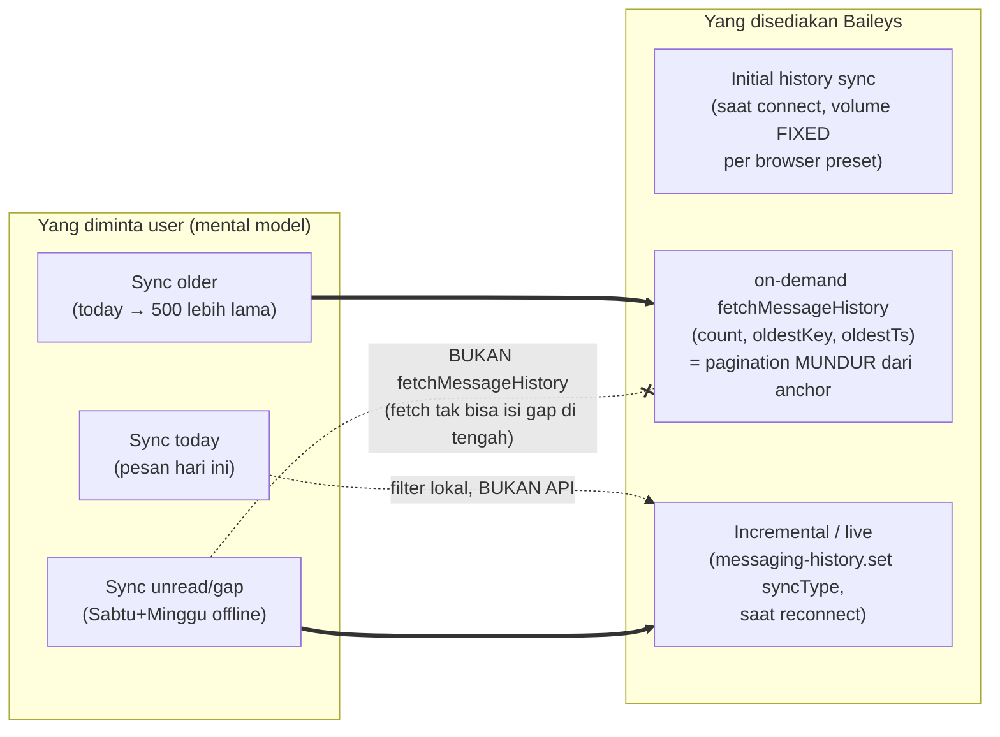
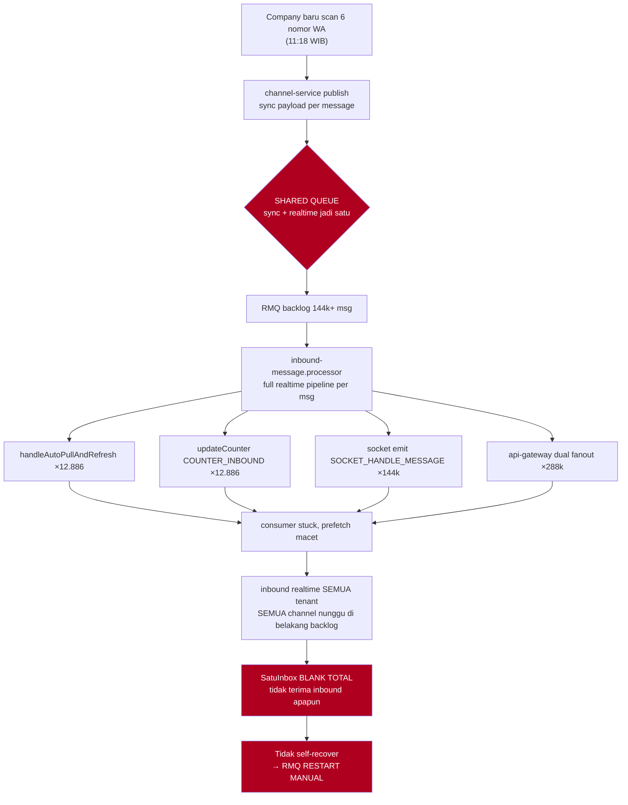
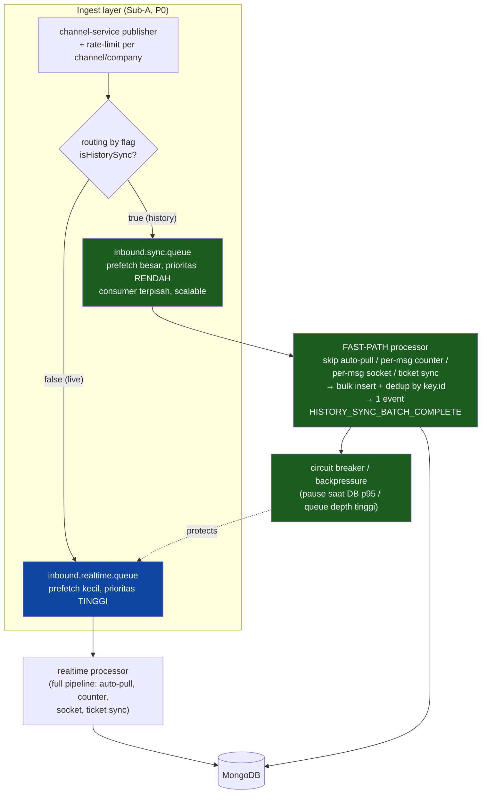
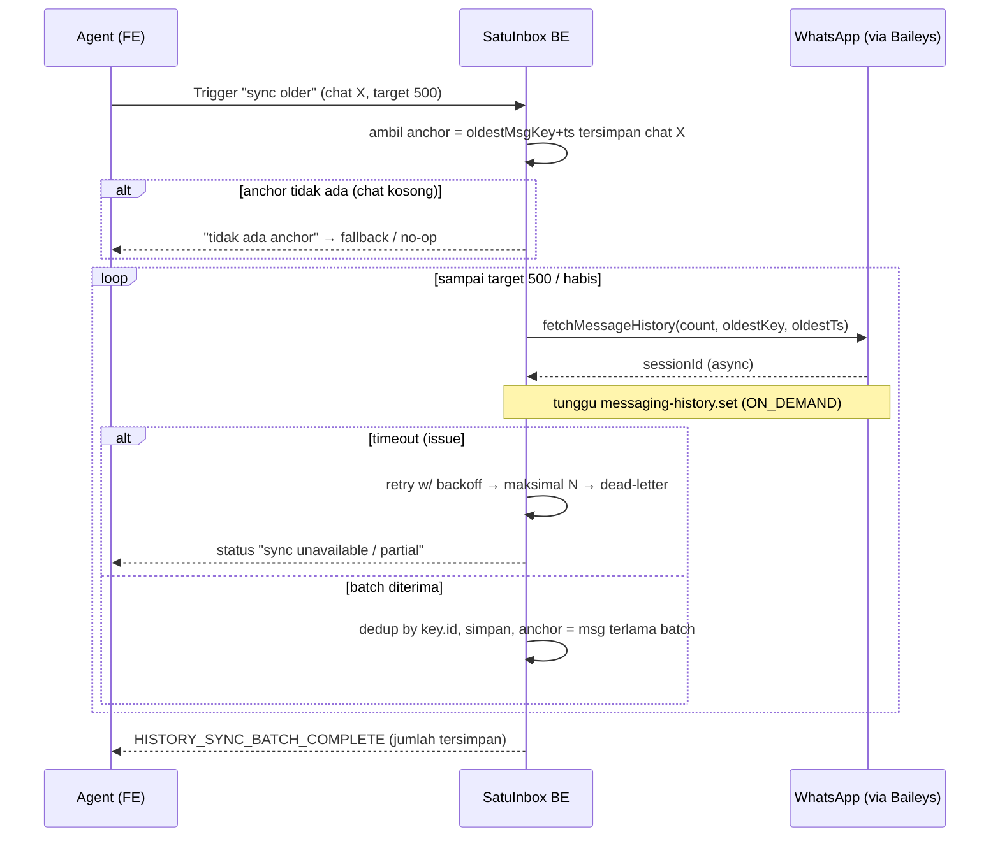

# Assessment Report: WhatsApp Baileys History Sync

> **Artifact Type:** Assessment Report (decision-bearing)
> **Artifact Path:** `Assessments/whatsapp-web/history-sync/history-sync-assessment.md`
> **Version:** `v1.0`
> **Owner:** Analyst / PM — Dany Christian
> **Engineering Lead:** Naftal Yunior
> **Source Brief:** `Assessments/whatsapp-web/history-sync/history-sync-change-intake-brief.md`
> **Rules Applied:** `Rules/core/analysis-and-risk.md`, `Rules/core/change-management.md`
> **Supporting Evidence:** `incident report/2026-07-20-pk12-10-rmq-sync-history-saturation.md`, Baileys docs (history-sync), Baileys issue #2452
> **Date:** 2026-10-13
> **Decision:** **`PROCEED_WITH_CAUTION` + `SPLIT_REQUEST`** — Sub-A (ingest hardening) adalah prasyarat GO untuk Sub-B/Sub-C.

---

## 1. Executive Summary

SatuInbox ingin membangun History Sync WhatsApp (Baileys) dalam 3 mode: **today**, **older (−500)**, dan **gap/unread (offline)**. Permintaan valid, tapi menyentuh pipeline yang **sudah terbukti menyebabkan outage total SEV-1** (incident 2026-07-20): scan 6 nomor → 12.886 conversation + 144k+ message → shared RMQ queue saturasi → semua channel inbound stop → recovery butuh RMQ restart manual.

Dua temuan menentukan keputusan:

1. **Baileys tidak punya API sync by-date/by-range.** Tiga mode user tidak dapat diimplementasi sebagai "ambil pesan tanggal X". Yang tersedia hanya: initial sync (volume fixed per browser preset), on-demand `fetchMessageHistory` (pagination mundur dari anchor), dan incremental/live saat reconnect. Mode "today" = filter lokal; Mode "older" = loop pagination; Mode "gap/unread" = jalur reconnect yang **berbeda** dari on-demand fetch.

2. **Fitur ini = remediation + fitur baru, bukan greenfield.** History ingest sudah berjalan (lewat pipeline inbound realtime) dan itulah yang mematikan sistem. Maka hardening ingest (queue split, fast-path, throttle, backpressure) adalah **prasyarat non-bypassable** sebelum fitur UI apa pun dibangun di atasnya.

**Rekomendasi:** split jadi 3 sub-scope; kerjakan **Sub-A (ingest hardening, P0)** lebih dulu; Sub-B/Sub-C hanya GO setelah Sub-A lulus guard incident.

---

## 2. Scope Diusulkan vs Realita Baileys

**Mapping kritis:**

| Mode user | Jalur Baileys nyata | Catatan |
|---|---|---|
| Sync today | Filter lokal dari live + initial sync | Tidak ada request by-date. "Today" per timezone company, bukan UTC server. |
| Sync older −500 | `fetchMessageHistory` **loop** | Pagination mundur dari anchor; bukan count absolut. Butuh anchor message tersimpan. |
| Sync unread (gap) | Reconnect / incremental replay | `fetchMessageHistory` **tidak bisa** ambil gap di tengah — hanya lebih lama dari anchor. Jalur terpisah. |

---

## 3. Current State — Kenapa Ini Berbahaya

### 3.1 Incident 2026-07-20 (SEV-1) — evidence langsung

**Root cause (incident §4):** RC-A shared queue (P0), RC-B no fast-path (P0), RC-C no throttle (P0), RC-D auto-pull per historis (P0), RC-E counter tercemar (P1), RC-F socket per historis (P1), RC-G no backpressure (P1).

### 3.2 Status implementasi
- **History ingest sudah SHIPPED** (bermasalah) — diproses sebagai inbound realtime, tanpa guard.
- **On-demand `fetchMessageHistory`**: belum dikonfirmasi diimplementasi di SatuInbox (perlu verifikasi BE repo).
- **FE UI sync (today/older/unread)**: belum ada (perlu verifikasi FE repo).

---

## 4. Target Architecture (Usulan)

**Prinsip:** realtime dan sync **tidak pernah** berbagi consumer path. Sync kalah prioritas, di-throttle, fast-path (tanpa hook realtime), dedup, dan dilindungi backpressure.

### 4.1 Mode B — pagination loop (on-demand)

---

## 5. Limitasi (Ringkas untuk PRD/QA)

| # | Limitasi | Konsekuensi desain |
|---|---|---|
| 1 | No by-date / by-range API | 3 mode harus di-map ke initial/on-demand/reconnect; "today" = filter lokal |
| 2 | Butuh anchor message | Chat kosong tak bisa fetch older → butuh fallback |
| 3 | On-demand async & bisa di-drop (issue #2452) | Wajib timeout + retry backoff + dead-letter + status ke user |
| 4 | Butuh HP utama online | Device mati → sync older gagal → state "sync unavailable" |
| 5 | Volume initial fixed per browser preset | Full history mahal (startup + memory) → bukan default |
| 6 | Gap offline ≠ fetch history | Mode C via reconnect/incremental, jalur terpisah |
| 7 | Media lama bisa expired | Teks diprioritaskan; media best-effort |
| 8 | Rate limit / ban WA | Backoff + cap request per window |
| 9 | Multi-tenant fan-out | Async job, bukan request path; throttle per channel/company |
| 10 | Timestamp UTC | "Today" per timezone company/agent |

---

## 6. Risk Register

| ID | Risk | Likelihood | Impact | Mitigasi |
|----|------|-----------|--------|----------|
| RK-1 | Reproduksi outage SEV-1 (shared queue) | High (terbukti) | Critical | Sub-A queue split WAJIB sebelum GO (incident B3) |
| RK-2 | Counter/SLA tercemar timestamp historis | High | High | Fast-path: skip per-msg counter, bulk delta; SLA abaikan historis (B4) |
| RK-3 | Agent inbox dibanjiri auto-pull 12k+ | High | High | Fast-path skip auto-pull; assignment batch pasca-sync (B4, struktural) |
| RK-4 | On-demand drop diam-diam (issue #2452) | Medium | Medium | Timeout+retry+DLQ+status |
| RK-5 | WA throttle/ban nomor karena fetch agresif | Medium | High | Rate-limit + backoff + cap per window (OQ-04/07) |
| RK-6 | Storage meledak (500 × N chat × M channel) | Medium | Medium | Cap + retention policy (OQ-04) |
| RK-7 | Pesan offline hilang (Mode C tak ter-handle) | Medium | High | Verifikasi reconnect/incremental handling (OQ-05) |
| RK-8 | Media expired → download gagal | High | Low | Teks prioritas; media best-effort (OQ-08) |

---

## 7. Decision & Rationale

**Decision: `PROCEED_WITH_CAUTION` + `SPLIT_REQUEST`.**

| Sub | Judul | Prioritas | Gate GO |
|-----|-------|-----------|---------|
| **Sub-A** | Ingest Hardening (queue split, fast-path, throttle, backpressure, dedup) | **P0** | Prasyarat; tanpa ini Sub-B/C tidak boleh deploy |
| **Sub-B** | On-Demand Sync UI (Mode A today + Mode B older pagination) | P1 | Setelah Sub-A lulus guard + OQ-04/06/07 locked |
| **Sub-C** | Offline Gap Sync (Mode C reconnect) | P1/P2 | Setelah OQ-05 verified |

**Rationale:** Sub-A mencegah pengulangan outage dan merapikan behavior existing yang sudah rusak. Membangun Sub-B/Sub-C di atas pipeline lama = menjadwalkan outage berikutnya. OQ blocking (§7 brief) harus terkunci sebelum PRD masing-masing sub.

---

## 8. Required Pre-Dev Locks (sebelum PRD)

1. Queue architecture final (OQ-01) — audit + split design.
2. Fast-path contract (OQ-02) — flag + hook yang di-skip + penggantinya.
3. Sync intent: inbound-like vs arsip/read-only (OQ-03).
4. Mode B target semantics + cap (OQ-04).
5. Mode C mechanism verified (OQ-05).
6. On-demand reliability policy (OQ-06).
7. Trigger & RBAC + rate-limit per user (OQ-07).

---

## 9. Next Steps

1. PM + Eng Lead + DevOps + Architecture: lock 7 OQ (§8).
2. Verifikasi di BE repo: apakah `fetchMessageHistory` sudah dipakai; audit RMQ queue definition (incident B1).
3. Verifikasi di FE repo: status UI sync.
4. Setelah OQ terkunci → tulis PRD Sub-A dulu (`PRD/Whatsapp web v2/History Sync/`).
5. QA pre-implementation: regression scope = seluruh inbound realtime path (semua tenant) + counter + assignment + socket storm + FE invalidation.

---

## 10. Change Log

| Date | Change | Author |
|------|--------|--------|
| 2026-10-13 | Initial assessment. Baileys 3-mode mapping, incident-backed risk register, target architecture (queue split + fast-path + backpressure), decision PROCEED_WITH_CAUTION + SPLIT_REQUEST (Sub-A P0 prerequisite). | Dany Christian (PM) |
